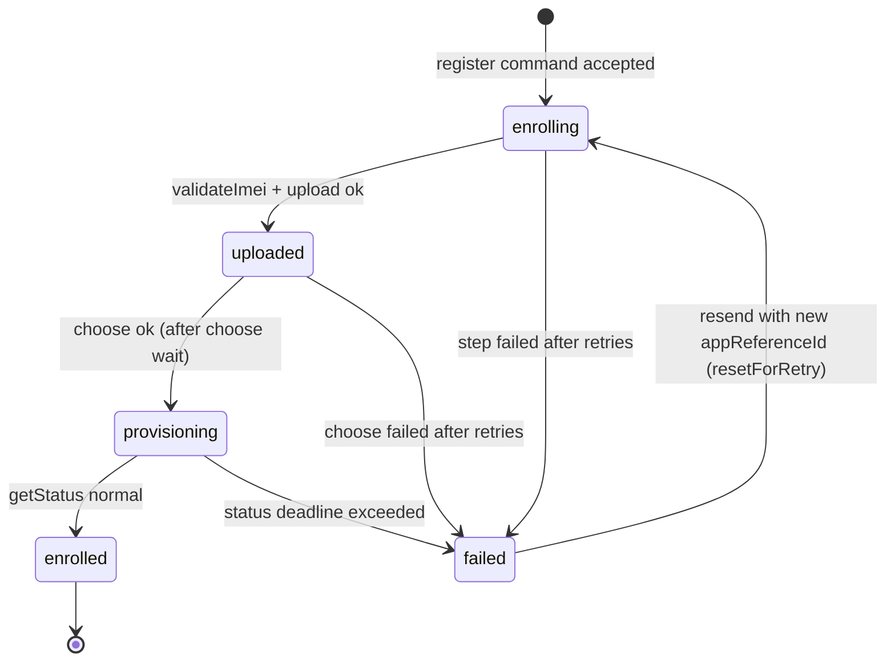
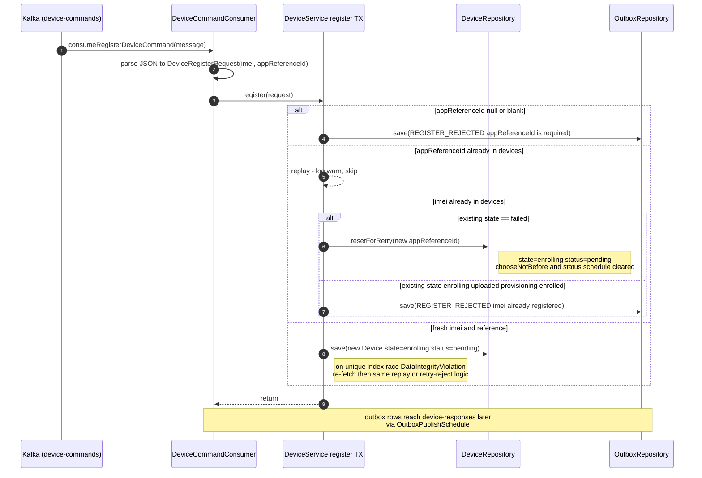
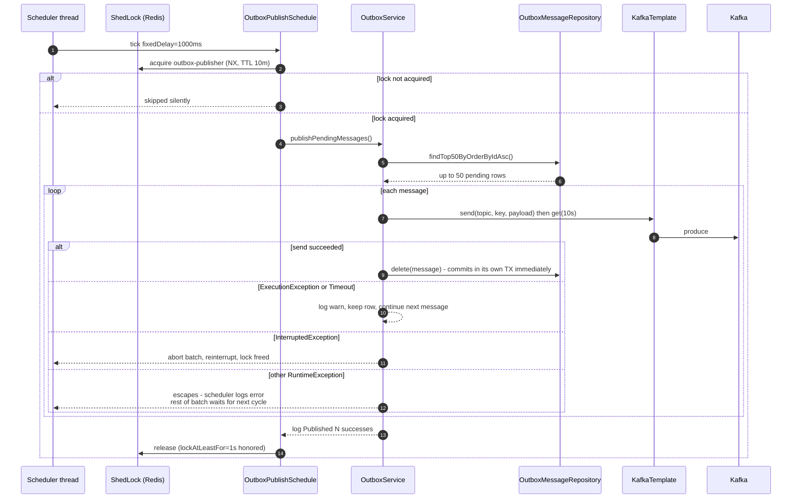
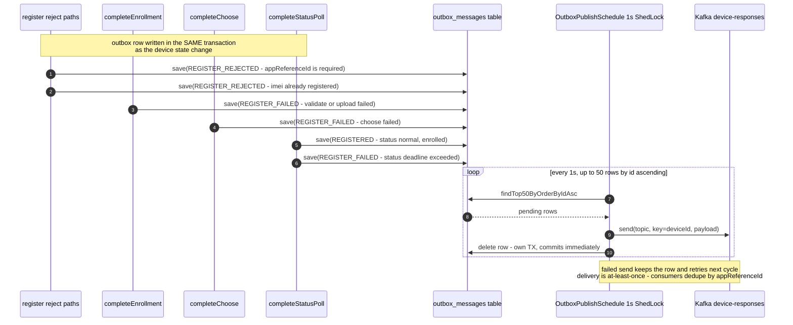
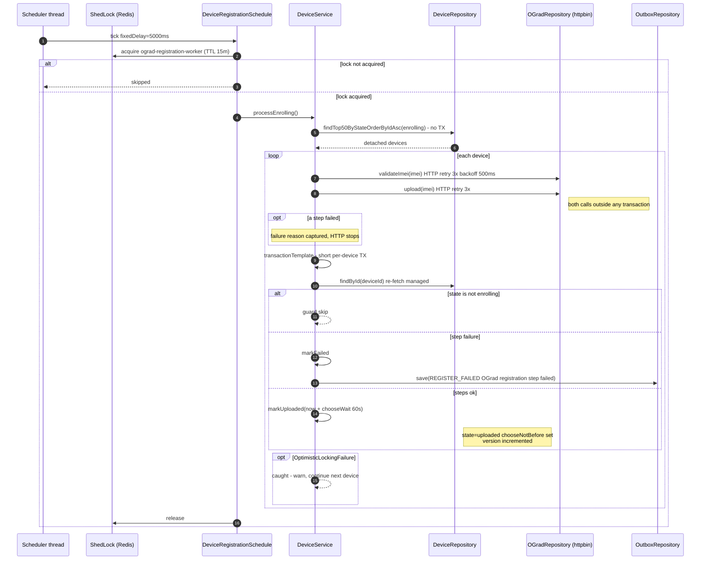
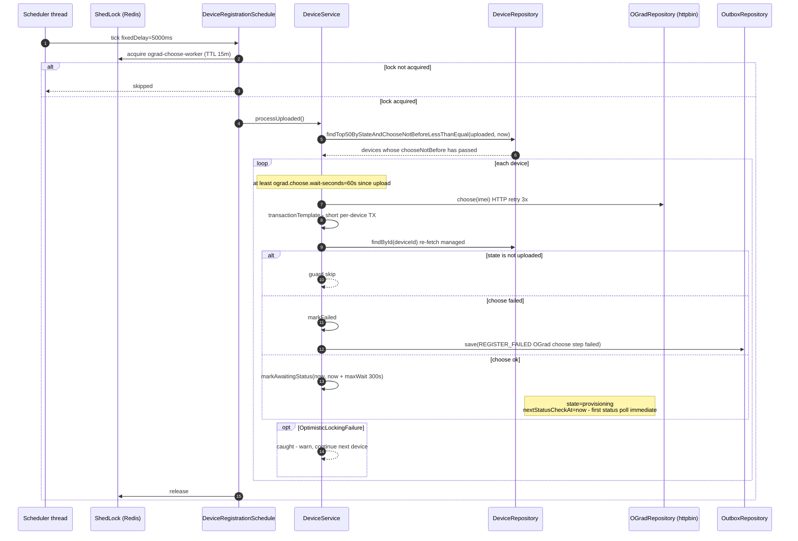
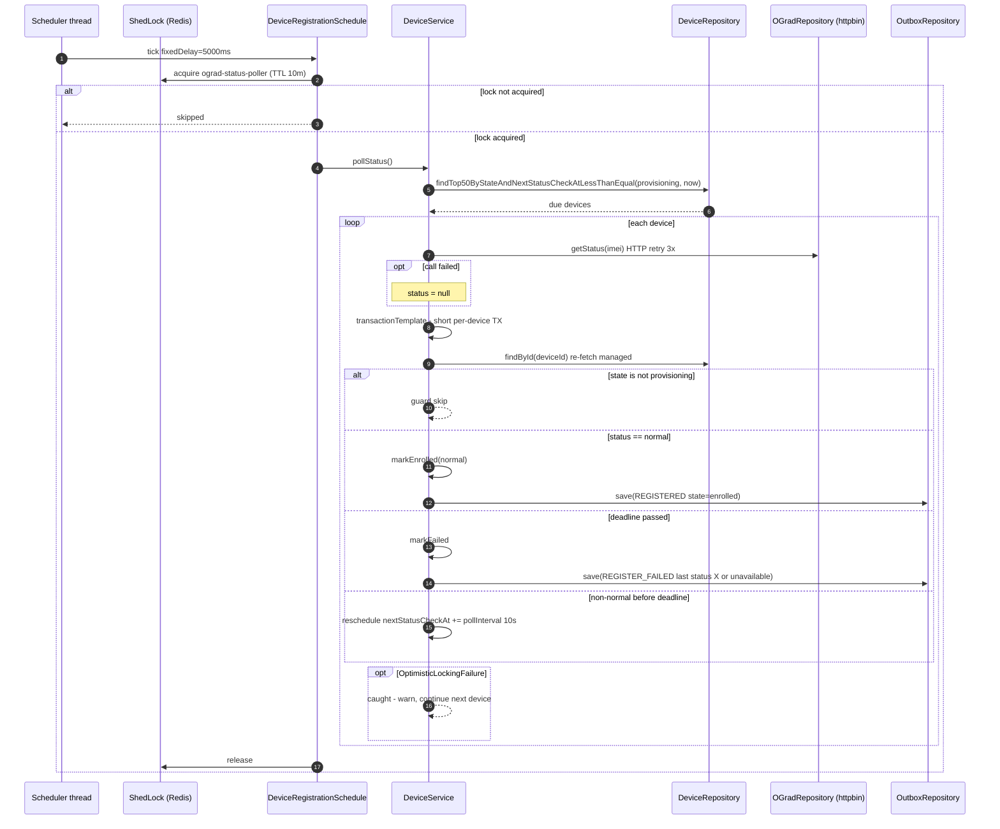

# gard-service — Runtime Flow Diagrams

gard-service consumes device-register commands from Kafka `device-commands`, drives the device
through the OGrad registration flow (validate IMEI, upload, wait, choose, wait for status), and
publishes exactly one response event (`REGISTERED`, `REGISTER_FAILED`, or `REGISTER_REJECTED`)
to `device-responses` via a durable outbox. All flow progress is stored in the `devices` table,
so every step survives crashes and resumes on any node.

## Device lifecycle

## 1. Register command received (`device-commands`)

## 2. OutboxPublishSchedule (every 1s)

## Outbox message lifecycle — creation to delivery

Every path that produces a device-response writes its outbox row **in the same transaction** as the
device state change (atomic: the row exists if and only if the state change committed). A single
ShedLock-guarded publisher drains all rows to `device-responses`.

## 3. processEnrolling (every 5s) — validate + upload

## 4. processUploaded (every 5s) — choose, after the 60s wait

## 5. pollStatus (every 5s) — getStatus until normal

