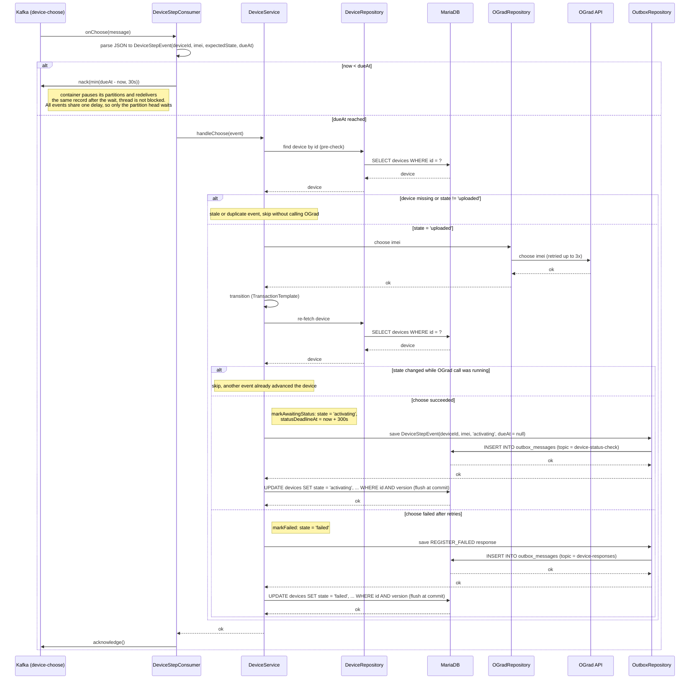

# Choose Step Consumer — onChoose

Sequence diagram for the `device-choose` listener (consumer group `gard-service-choose`,
`max.poll.records=1`), which waits until the event's `dueAt` (choose wait passed), calls OGrad
`choose`, transitions the device to `activating` and queues the first status check.

