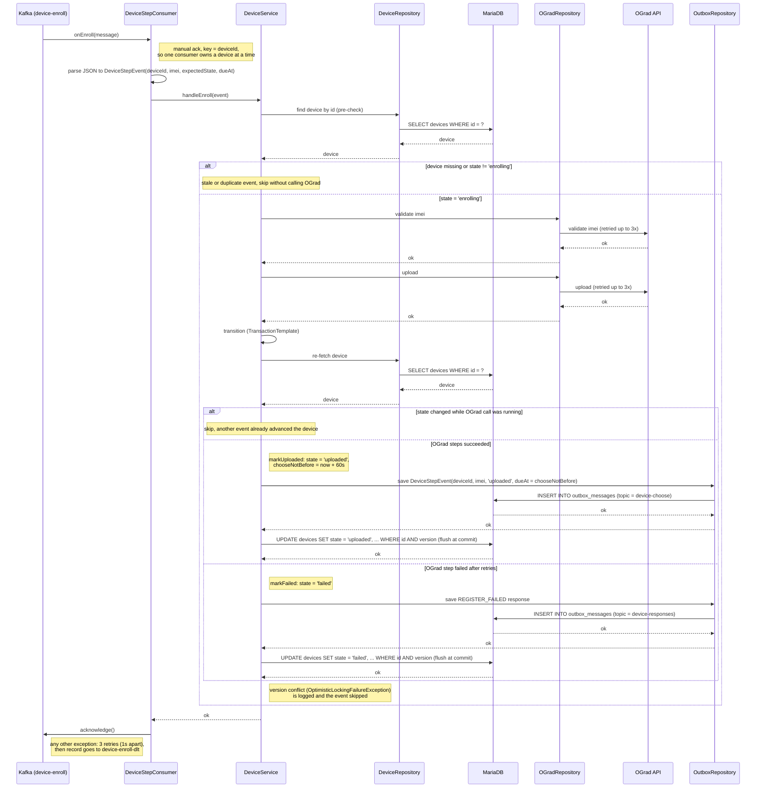

# Enroll Step Consumer — onEnroll

Sequence diagram for the `device-enroll` listener (consumer group `gard-service-enroll`,
`max.poll.records=1`), which drives an `enrolling` device through OGrad `validateImei` + `upload`,
transitions it to `uploaded` and queues the delayed choose step.

