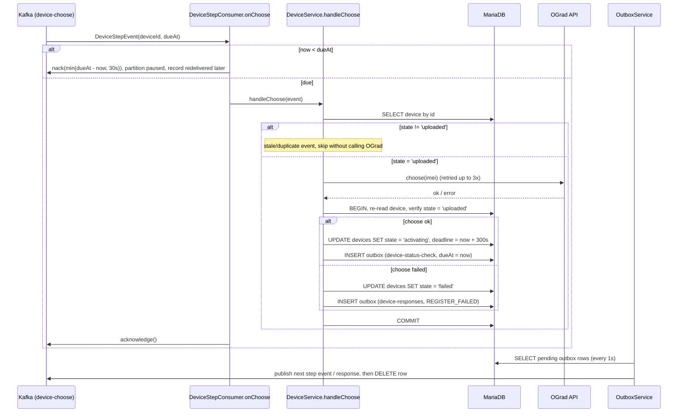

# Kafka-Driven Registration Workflow

Each registration step is triggered by a Kafka event instead of a polling scheduler. A step calls OGrad
outside any transaction, then in **one transaction** re-reads the device, checks it is still in the
expected state, applies the transition and writes the next step event to the outbox. `OutboxService`
publishes outbox rows to Kafka in id order (stopping at the first failure so per-device order is kept).

```
device-commands ──► register ─────────(outbox)──► device-enroll
device-enroll   ──► validateImei + upload ─(outbox)──► device-choose        (dueAt = now + 60s)
device-choose   ──► wait for dueAt, choose ─(outbox)──► device-status-check (dueAt = now)
device-status-check ──► wait for dueAt, getStatus
      ├─ normal          ──(outbox)──► device-responses  REGISTERED
      ├─ past deadline   ──(outbox)──► device-responses  REGISTER_FAILED
      └─ otherwise       ──(outbox)──► device-status-check (dueAt = now + 10s)
any OGrad step failure   ──(outbox)──► device-responses  REGISTER_FAILED
```

| Topic | Consumer group | Payload |
|---|---|---|
| `device-enroll` | `gard-service-enroll` | `DeviceStepEvent{deviceId, imei, expectedState, dueAt}` |
| `device-choose` | `gard-service-choose` | same, `dueAt` = chooseNotBefore |
| `device-status-check` | `gard-service-status-check` | same, `dueAt` = next check |
| `<topic>-dlt` | — | events that failed 3 retries (malformed JSON goes straight here) |

Step events are keyed by `deviceId`, so a device's events stay on one partition and are handled by one
consumer at a time. All topics are declared at startup by `KafkaTopicConfig` (`device.kafka.partitions`).

## Delayed steps

Kafka has no delayed delivery. Every event in a delay topic has the same delay, so a partition is already
in `dueAt` order and only its head record ever waits. When the head is not due yet the listener calls
`Acknowledgment.nack(wait)`: the container pauses its partitions and redelivers the same record later,
without blocking the thread. Waits are capped at 30s (`MAX_PAUSE`) to stay well under
`max.poll.interval.ms`. Each step has its own listener container and consumer group, so pausing one step
never delays or rebalances another.

## Idempotency and safety

- **Duplicate or stale events are harmless**: each handler checks the device state before calling OGrad
  and again inside the transaction; `@Version` rejects concurrent updates.
- **Stuck-device sweeper** (`DeviceSweeperSchedule`, every `device.sweeper.interval-ms`, ShedLock
  `device-stuck-sweeper`): devices in `enrolling` / `uploaded` / `activating` unchanged for
  `device.sweeper.stuck-seconds` get their current step event re-queued. This recovers events that went to a
  DLT, and devices left in flight by the earlier scheduler-based version.
- OGrad `upload` / `choose` can run twice if the process dies after the call but before the commit, so they
  must be idempotent on the OGrad side.

## Step sequence (choose shown; enroll and status check follow the same shape)


