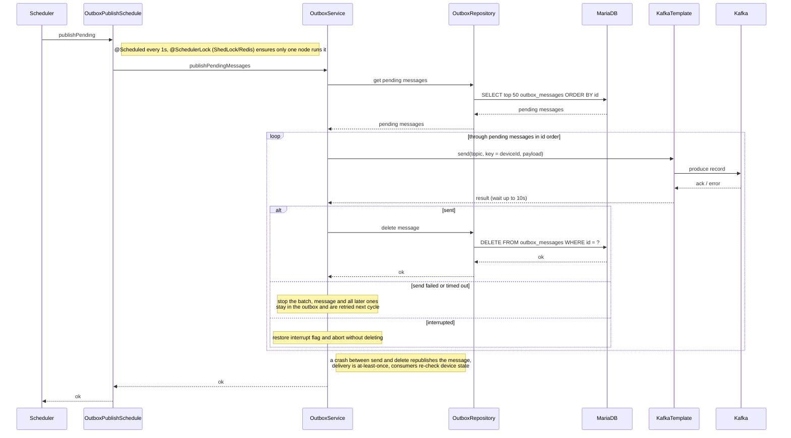

# Outbox Publisher — publishPendingMessages

Sequence diagram for the `publishPending` scheduled job (every 1s, ShedLock `outbox-publisher`), which
sends outbox rows (step events and responses) to Kafka in id order. It stops the batch at the first
failed send so a device's events are never published out of order.

