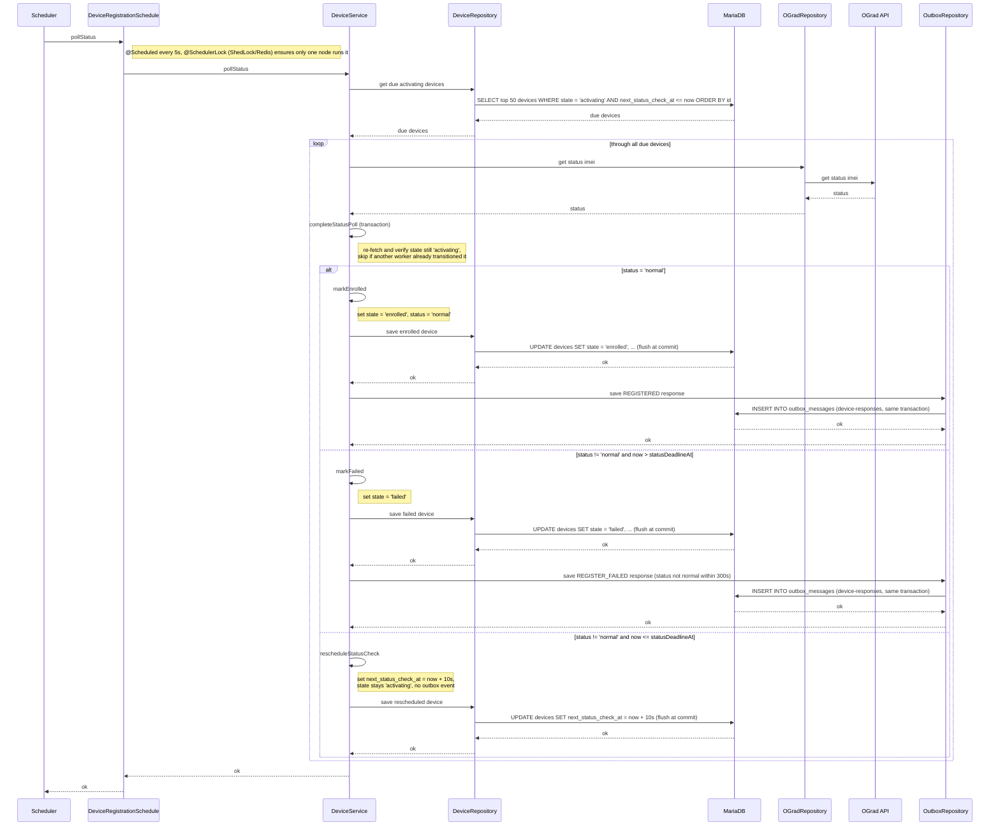

# Status Poller Worker — pollStatus

Sequence diagram for the `pollStatus` scheduled job (every 5s, ShedLock
`ograd-status-poller`), which polls `activating` devices whose status check is due
and transitions them to `enrolled` once OGrad reports status `normal`.
No per-device lease is claimed here: `getStatus` is read-only, so a duplicate poll is harmless.

