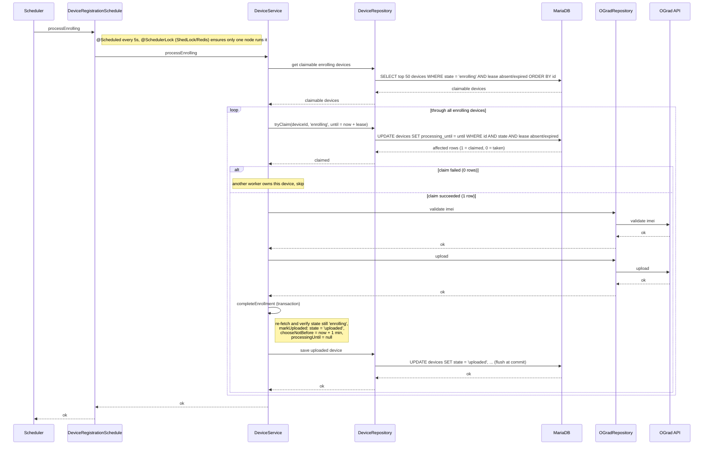

# Registration Worker — processEnrolling

Sequence diagram for the `processEnrolling` scheduled job (every 5s, ShedLock
`ograd-registration-worker`), which drives `enrolling` devices through OGrad
`validateImei` + `upload` and transitions them to `uploaded`.

