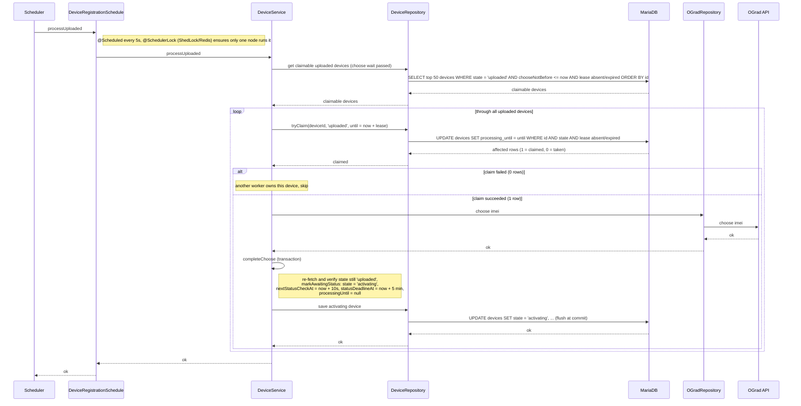

# Choose Worker — processUploaded

Sequence diagram for the `processUploaded` scheduled job (every 5s, ShedLock
`ograd-choose-worker`), which picks `uploaded` devices whose choose wait has passed,
calls OGrad `choose` and transitions them to `activating` with a status-poll schedule.

