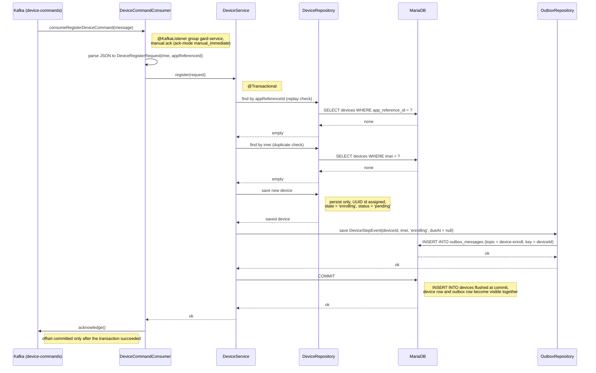

# Register Command Consumer — consumeRegisterDeviceCommand

Sequence diagram (happy path) for consuming a register command from Kafka
`device-commands`: the consumer parses the message, `DeviceService.register()` saves a new
`enrolling` device and writes its first step event (`device-enroll`) to the outbox in the same
transaction. The outbox publisher then sends it to Kafka (see `outbox-publish-sequence.md`).

