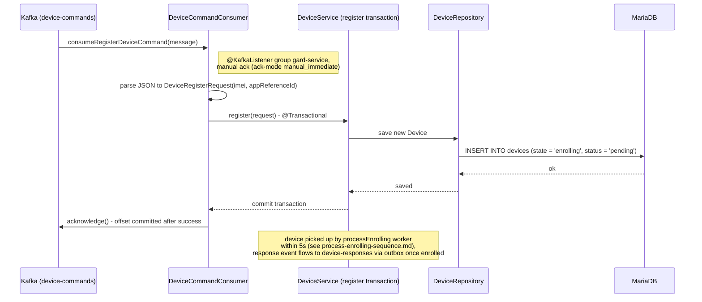

# Register Command Consumer — consumeRegisterDeviceCommand

Sequence diagram (happy path) for consuming a register command from Kafka
`device-commands`: the consumer parses the message and `DeviceService.register()`
saves a new `enrolling` device for the registration workers to pick up.

