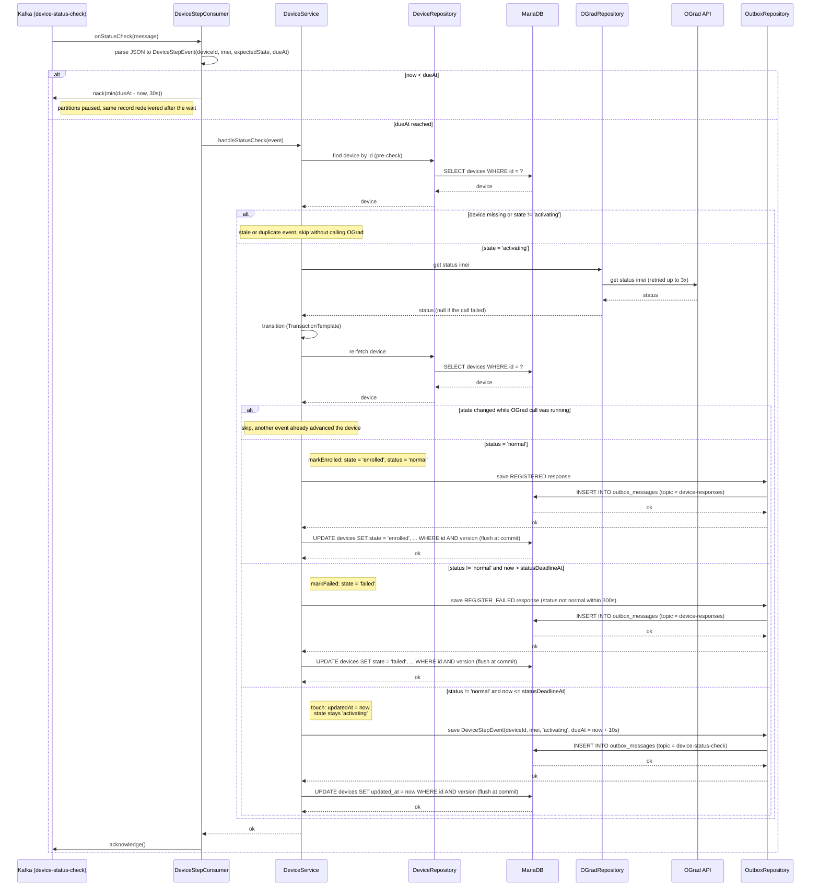

# Status Check Step Consumer — onStatusCheck

Sequence diagram for the `device-status-check` listener (consumer group `gard-service-status-check`,
`max.poll.records=1`), which waits until the event's `dueAt`, polls OGrad status for an `activating`
device and either enrolls it, fails it after the deadline, or queues the next check.

