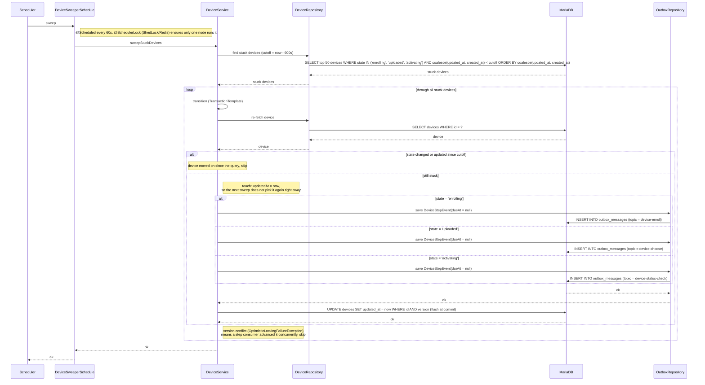

# Stuck Device Sweeper — sweepStuckDevices

Sequence diagram for the `sweep` scheduled job (every 60s, ShedLock `device-stuck-sweeper`), the safety
net of the Kafka-driven workflow. It re-queues the current step event for devices that have stayed in a
non-final state longer than `device.sweeper.stuck-seconds` (600s), e.g. because their event went to a
DLT or they were left in flight by the earlier scheduler-based version. Re-queuing is safe because every
step re-checks the device state. Events are re-queued with no delay: `stuck-seconds` must exceed the choose
wait (checked at startup), so any choose wait has already passed.

